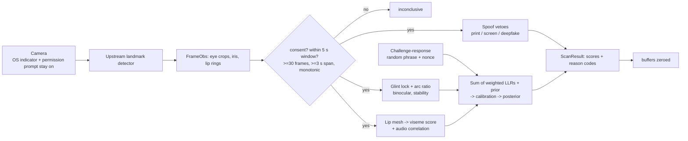

# VulnTriage

AI-powered vulnerability triage with biometric submission gating.

- **Triage agent** — live Nemotron call via Nebius Token Factory, CVSS scoring, MITRE ATT&CK mapping, structured remediation JSON
- **AURA gate** — corneal glint-arc geometry + lip-sync viseme fusion (weighted log-odds, distance-adaptive weights, target false-accept 1 in 100,000)
- **Geometry discovery engine** — Fisher-information proxy, manifold curvature, topological depth steer an agent toward the hardest unsolved problems
- **CI** — GitHub Actions runs the full suite on every push

## Quick start

```bash
export NEBIUS_API_KEY=v1.your_token_factory_key
pip install -r requirements.txt
python src/agent.py
```

## Tests

```bash
bash run_tests.sh
```

## Silent scan

`crates/aura-rs/src/scan.rs` (Rust) and `src/aura_scan.py` (Python mirror) add a
5-second **liveness** scan with no visible UI. It consumes per-frame landmarks and
grayscale eye crops from an upstream face-landmark detector (not bundled; the
optional `capture_and_scan()` adapter uses OpenCV + MediaPipe Face Mesh with
`refine_landmarks=True`, opens no window, draws nothing). Output is scores,
pass/fail and reason codes only.



**Fusion.** Legacy `fuse()` (weighted average, pass ≥ 0.85) is unchanged and still
reported as `legacy_pass`. The new tier sums reliability-weighted log-likelihood
ratios: `LLR = w_g·(glint + binocular + stability) + w_l·(lip + av) + blink + jitter (+ challenge)`,
with `w = (1.0, 0.6)` close (eye ≥ 60 px) and `(0.3, 1.0)` at range. Glint LLR is a
Gaussian test of arc ratio 0.5 (live cornea) vs 1.0 (flat), σ = 0.05 + 3/eye_width_px.
High-assurance pass = no veto ∧ posterior ≥ 0.999 ∧ LLR ≥ ln(1/TARGET_FALSE_ACCEPT) = 11.51.

**Vetoes.** Printed photo (flat glint, planar affine motion, static mesh), screen replay
(moiré, flicker, rectangular/doubled glint, duplicated frames), deepfake (AV desync,
jitter outside natural range, glint/light-direction mismatch), challenge failed.

**Challenge-response** (`challenge.rs`, `src/aura_challenge.py`). A random 4–6 word
phrase from a fixed 14-word vocabulary with a one-time nonce is spoken (pyttsx3 → `say`
→ `espeak` → returned as display text). Lip-mesh features are snapped to 7 viseme
classes, split into words at rest pauses, decoded per word by DTW against each word's
phoneme→viseme sequence, then aligned to the phrase by edit distance. Starting before
the prompt ends, wrong words, too-fast delivery or a reused nonce fail. This is
closed-vocabulary verification of a prompted phrase, **not** open transcription. A real
VSR model (Auto-AVSR / AV-HuBERT) can be plugged into `VisualSpeechRecognizer`; none is bundled.

**Guardrails.** Requires `consent=True`. Never suppresses the camera indicator or
permission prompt. Nothing is persisted; no template is kept; no identification.
Recognized words may be spoken back once, only inside the same consented session.

**Accuracy.** 99.9% and 1e-5 are *design targets*, not measured accuracy. All thresholds
are hand-set and uncalibrated (calibration hook: `Calibration::from_config`). The eval
harness (`cargo run --release --example eval`) reports synthetic FAR/FRR only.
