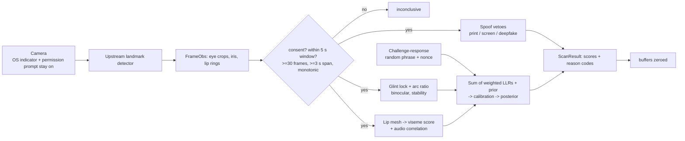

# VulnTriage

AI-powered vulnerability triage with biometric submission gating.

- **Triage agent** — live Nemotron call via Nebius Token Factory, CVSS scoring, MITRE ATT&CK mapping, structured remediation JSON
- **AURA gate** — corneal glint-arc geometry + lip-sync viseme fusion (weighted log-odds, distance-adaptive weights, target false-accept 1 in 100,000)
- **Geometry discovery engine** — Fisher-information proxy, manifold curvature, topological depth steer an agent toward the hardest unsolved problems
- **CI** — GitHub Actions runs the full suite on every push

## Quick start

```bash
export NEBIUS_API_KEY=v1.your_token_factory_key
pip install -r requirements.txt
python src/agent.py
```

## How VulnTriage uses NVIDIA Nemotron and Nebius Token Factory

All LLM inference runs on **NVIDIA Nemotron** models served by **Nebius Token Factory**
(`src/agent.py`). The agent uses the `openai` Python client pointed at Token Factory's
OpenAI-compatible endpoint, `https://api.tokenfactory.nebius.com/v1`.

| Tier | Model | Used for |
|---|---|---|
| `nano` | `nvidia/llama-3.1-nemotron-nano-8b-v1` | fastest/cheapest; used by the `python src/agent.py` demo |
| `super` | `nvidia/llama-3.1-nemotron-70b-instruct` | mid-size option |
| `ultra` | `nvidia/llama-3.1-nemotron-ultra-253b-v1` | default for `triage()`; also the fallback for an unknown tier |

The tier is picked by the caller (`triage(report, tier=...)`); all tiers run the same
prompt. Flow: the AURA liveness gate runs first, and if it fails, no model is called.
Otherwise one chat completion is made (`temperature=0.0`) with a system prompt asking the model, acting as an AppSec
engineer, to classify severity using CVSS, map the report to a MITRE ATT&CK technique and write a
remediation plan as strict JSON (`severity`, `cvss_score`, `attack_technique`, `summary`,
`remediation_steps`, `affected_assets`, `estimated_effort`, `priority`). Code fences are
stripped and the JSON is schema-checked: severity enum, CVSS score 0–10, non-empty steps, effort S/M/L, priority 1–5.

**API key.** Create an account at https://tokenfactory.nebius.com (Google or GitHub
login), open **API keys**, click **Create API key** and copy it. It is shown only once. Then run
`export NEBIUS_API_KEY=v1....`. The agent exits if the key is missing or doesn't start with `v1.`.

**Tests** (`tests/test_agent.py`) mock the Token Factory client (`TestMockedTokenFactory`,
`TestModelTierRouting`), so CI needs no key or network.

## Tests

```bash
bash run_tests.sh
```

## Bundled app

Run the whole thing (AURA gate → triage → records → dashboard) with `python app/server.py` and open http://localhost:8000. See [app/README.md](app/README.md).

## Silent scan

`crates/aura-rs/src/scan.rs` (Rust) and `src/aura_scan.py` (Python mirror) add a
5-second **liveness** scan with no visible UI. It consumes per-frame landmarks and
grayscale eye crops from an upstream face-landmark detector (not bundled; the
optional `capture_and_scan()` adapter uses OpenCV + MediaPipe Face Mesh with
`refine_landmarks=True`, opens no window, draws nothing). Output is scores,
pass/fail and reason codes only.



**Fusion.** Legacy `fuse()` (weighted average, pass ≥ 0.85) is unchanged and still
reported as `legacy_pass`. The new tier sums reliability-weighted log-likelihood
ratios: `LLR = w_g·(glint + binocular + stability) + w_l·(lip + av) + blink + jitter (+ challenge)`,
with `w = (1.0, 0.6)` close (eye ≥ 60 px) and `(0.3, 1.0)` at range. Glint LLR is a
Gaussian test of arc ratio 0.5 (live cornea) vs 1.0 (flat), σ = 0.05 + 3/eye_width_px.
High-assurance pass = no veto ∧ posterior ≥ 0.999 ∧ LLR ≥ ln(1/TARGET_FALSE_ACCEPT) = 11.51.

**Vetoes.** Printed photo (flat glint, planar affine motion, static mesh), screen replay
(moiré, flicker, rectangular/doubled glint, duplicated frames), deepfake (AV desync,
jitter outside natural range, glint/light-direction mismatch), challenge failed.

**Challenge-response** (`challenge.rs`, `src/aura_challenge.py`). A random 4–6 word
phrase from a fixed 14-word vocabulary with a one-time nonce is spoken (pyttsx3 → `say`
→ `espeak` → returned as display text). Lip-mesh features are snapped to 7 viseme
classes, split into words at rest pauses, decoded per word by DTW against each word's
phoneme→viseme sequence, then aligned to the phrase by edit distance. Starting before
the prompt ends, wrong words, too-fast delivery or a reused nonce fail. This is
closed-vocabulary verification of a prompted phrase, **not** open transcription. A real
VSR model (Auto-AVSR / AV-HuBERT) can be plugged into `VisualSpeechRecognizer`; none is bundled.

**Guardrails.** Requires `consent=True`. Never suppresses the camera indicator or
permission prompt. Nothing is persisted; no template is kept; no identification.
Recognized words may be spoken back once, only inside the same consented session.

**Accuracy.** 99.9% and 1e-5 are *design targets*, not measured accuracy. All thresholds
are hand-set and uncalibrated (calibration hook: `Calibration::from_config`). The eval
harness (`cargo run --release --example eval`) reports synthetic FAR/FRR only.

**Pretrained PAD channel** (`src/aura_pad.py`). In camera mode the browser samples up to 5 face crops,
about 1 s apart (80×80 BGR at 2.7× the face box). They are sent once with the scan, scored on the server with
onnxruntime, then zeroed. Nothing is stored and nothing is identity-matched. The model is **MiniFASNetV2 (2.7_80x80)** from
[minivision-ai/Silent-Face-Anti-Spoofing](https://github.com/minivision-ai/Silent-Face-Anti-Spoofing)
(Apache-2.0), using the ONNX export at
[garciafido/minifasnet-v2-anti-spoofing-onnx](https://huggingface.co/garciafido/minifasnet-v2-anti-spoofing-onnx)
(Apache-2.0, 1.7 MB). It is downloaded at runtime to `~/.cache/vulntriage/` and SHA-256 checked, not vendored.
Upstream doesn't document its training data, so we make no claim about it (not CelebA-Spoof/OULU/SiW).
The mean live probability becomes `pad_llr = clip(0.75·logit(p), ±3)` in the same LLR sum as the other channels.
`PADSpoof` vetoes only when every one of ≥ 3 crops has p_live < 0.05. With no crops, no onnxruntime or no model, the result is
`PADInconclusive`, which contributes 0, and the other channels still run. **Uncalibrated**: on our own recorded test videos, the scores
varied widely between real-person clips (mean p_live 0.03–1.0), so treat this channel as weak evidence.
