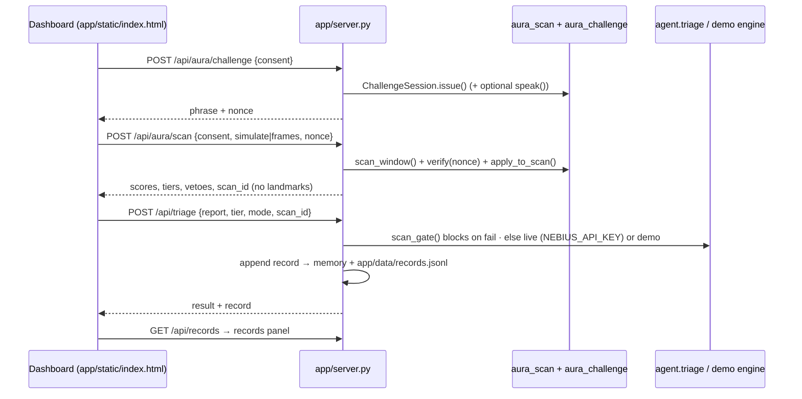

# VulnTriage + AURA — bundled app

One local app: **AURA silent liveness gate → VulnTriage triage → records → dashboard**.
Zero extra dependencies for the server (Python stdlib `http.server`); `openai` is only
needed for live Nebius Token Factory calls.

## Run (macOS)

```bash
cd vta-scan                      # repo root
python3 -m venv .venv && source .venv/bin/activate
pip install -r requirements.txt
python app/server.py             # → http://localhost:8000
open http://localhost:8000
# optional live model calls:
export NEBIUS_API_KEY=v1.xxxxx && python app/server.py   # then toggle LIVE in the header
```

In the **AURA gate** panel pick *Simulate live person* or *Simulate photo / replay /
deepfake* (synthetic landmark sequences generated server-side — clearly **simulated**),
keep the consent box ticked, and press **▶ Run triage**. The run issues a challenge
phrase + nonce, scans, folds in the challenge, triages (or blocks), writes a record, and
refreshes the **VulnTriage records** panel. `?autorun=<Kind>` runs one automatically.
If the backend is unreachable, the page falls back to its original offline demo mode.

## How the pieces connect



| Endpoint | Purpose |
|---|---|
| `GET /` | dashboard |
| `GET /api/health` | backend up, live mode available, simulate kinds |
| `POST /api/aura/challenge` | `{consent:true, tts?:bool}` → phrase, nonce, prompt_end_ms |
| `POST /api/aura/scan` | `{consent:true, simulate:"Live"\|..., or frames:[...], nonce?, challenge_response?}` |
| `POST /api/triage` | `{report, tier, mode:"demo"\|"live", scan_id?}`; a scan_id is single-use |
| `POST /api/run` | all of the above in one call (curl demos) |
| `GET /api/records` | records list |

**Records** contain timestamp, posterior, evidence (LLRs), legacy score, pass tiers, veto
and reason codes, challenge match ratio and the triage JSON — never images, landmarks or
recognized words. `app/data/` is gitignored.

**Real camera**: needs an upstream face-landmark detector (e.g. MediaPipe Face Mesh in
the browser, or `aura_scan.capture_and_scan()` server-side) producing `frames` in the
`FrameObs` JSON shape; not wired into the page in this build. The browser/OS camera
indicator and permission prompt must stay in effect.

**Limits**: simulated inputs only in the UI; thresholds uncalibrated; 0.999 / 1e-5 are
design targets, not measured accuracy; single-process in-memory challenge session;
localhost only, no auth.
