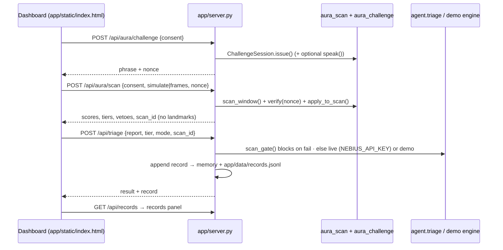

# VulnTriage + AURA — bundled app

One local app: **AURA silent liveness gate → VulnTriage triage → records → dashboard**.
Zero extra dependencies for the server (Python stdlib `http.server`); `openai` is only
needed for live Nebius Token Factory calls.

## Run (macOS)

```bash
cd vta-scan                      # repo root
python3 -m venv .venv && source .venv/bin/activate
pip install -r requirements.txt
python app/server.py             # → http://localhost:8000
open http://localhost:8000
# optional live model calls:
export NEBIUS_API_KEY=v1.xxxxx && python app/server.py   # then toggle LIVE in the header
```

In the **AURA gate** panel pick *Simulate live person* or *Simulate photo / replay /
deepfake* (synthetic landmark sequences generated server-side — clearly **simulated**),
keep the consent box ticked, and press **▶ Run triage**. The run issues a challenge
phrase + nonce, scans, folds in the challenge, triages (or blocks), writes a record, and
refreshes the **VulnTriage records** panel. `?autorun=<Kind>` runs one automatically.
If the backend is unreachable, the page falls back to its original offline demo mode.

## Live camera test on your Mac (Chrome or Safari)

```bash
git checkout feature/aura-live-camera && git pull
source .venv/bin/activate && python app/server.py
open http://localhost:8000
```

1. AURA gate panel → *Silent scan source* → **Live camera · your webcam**.
2. Tick the consent box (it is cleared every time you pick Live camera).
3. Paste/pick a report and press **▶ Run triage**; allow the camera in the browser prompt.
4. The phrase is shown and spoken ("Please say: …"). Wait for the voice to finish, then say it
   clearly, facing the camera in good light. Status reads *Camera active — liveness check in progress*;
   the camera stops after ~9 s (prompt + 6 s).
5. Read the gate result; tick **Debug: show raw scores** for per-channel LLRs, vetoes and the
   challenge codes. The record appears in *VulnTriage records*.

MediaPipe FaceLandmarker (tasks-vision 0.10.14, jsDelivr) and `face_landmarker.task` load from the
internet; if offline the panel says so and simulated mode keeps working. Eye crops (grayscale) are
sent once with the scan request and dropped after scoring; nothing image-like is logged or stored.
The silent scan scores the 5 s after the prompt ends (you are speaking), the challenge uses the
same frames' lip features. Jitter is normalised to 30 fps (2nd differences scale with dt²) so
slower in-browser detection doesn't trip `JitterOutOfRange`.

## How the pieces connect



| Endpoint | Purpose |
|---|---|
| `GET /` | dashboard |
| `GET /api/health` | backend up, live mode available, simulate kinds |
| `POST /api/aura/challenge` | `{consent:true, tts?:bool}` → phrase, nonce, prompt_end_ms |
| `POST /api/aura/scan` | `{consent:true, simulate:"Live"\|..., or frames:[...], nonce?, challenge_response?}` |
| `POST /api/triage` | `{report, tier, mode:"demo"\|"live", scan_id?}`; a scan_id is single-use |
| `POST /api/run` | all of the above in one call (curl demos) |
| `GET /api/records` | records list |

**Records** contain timestamp, posterior, evidence (LLRs), legacy score, pass tiers, veto
and reason codes, challenge match ratio and the triage JSON — never images, landmarks or
recognized words. `app/data/` is gitignored.

**Real camera**: wired via `app/static/aura-camera.js` (MediaPipe in the browser). The browser/OS camera
indicator and permission prompt must stay in effect.

**Limits**: simulated inputs only in the UI; thresholds uncalibrated; 0.999 / 1e-5 are
design targets, not measured accuracy; single-process in-memory challenge session;
localhost only, no auth.

## Calibration (opt-in)

Tick **Calibration recording**, pick the true label (live / printed photo / screen replay / deepfake / mask) and run a scan.
Only the label and the evidence LLR scalars, vetoes and reasons are appended to `app/data/calibration.jsonl`. No images, landmarks or identifiers are saved.
Then run `python tools/calibrate.py` (add `--isotonic` if you have plenty of data). It runs a Platt fit with 5-fold CV and prints FAR/FRR at the 0.85 and 0.999 tiers, with a Clopper-Pearson 95% upper bound on FAR.
It writes `app/data/calibration.cfg`, which the server loads at startup (`AURA_CALIBRATION=path` overrides it). Until then every result says `calibrated: false`.
The 1e-5 and 99.9% figures are design targets. Showing FAR ≤ 1e-5 takes about 300,000 spoof attempts with zero accepts (rule of three). FAR ≤ 1e-6 takes about 3,000,000. FRR ≤ 0.1% takes about 3,000 live attempts.

## Webcam-only channels (Python only; the Rust crate scores the canonical silent scan)

Each channel adds an LLR to `total_llr`, and its codes show in the debug panel. `geometry_llr` scores lip-shape dynamics. `attention_llr` uses eyeLook/eyeBlink and adds `Inattentive` (soft fail) and `EyesClosed`. `consistency_llr` adds `FrameTeleport`, `BlendshapeJitter` (only at ≥20 fps) and `IrregularTiming`. `planarity_llr` fits a homography to 12 landmarks and vetoes `PlanarFace` once there is ≥8° of yaw (otherwise `PoseTooStatic3D`). `rppg_llr` (POS/CHROM, 0.7–4 Hz, 3 ROIs) vetoes `NoPulse` only in adequate light (otherwise `LowLight`) and needs ≥5 s at ≥10 fps (otherwise `RppgShort`).
The browser sends only the rPPG ROI mean RGB and 12 sparse points. None of it is stored.
How this compares with Face ID: these are liveness-only analogues of its attention, depth and anti-spoof checks, built on an RGB webcam. There is no IR dot projector or depth sensor, and there is **no identity matching or face template**. That makes the assurance much weaker, and every threshold here is an uncalibrated design value.

### Screen-flash colour challenge (active light)

In camera mode, with consent ticked and **Color challenge** on (the default), `/api/aura/challenge` returns
`flash.seq`: 6 random colour segments of 450 ms each (red, green, blue, magenta, cyan and yellow, with no
colour repeated back-to-back), starting 300 ms after t0 and bound to the nonce. The page shows them as a
soft full-screen overlay during the first ~3 s, overlapping the spoken prompt. The browser sends only the
mean RGB of the rPPG skin ROIs plus one background ROI per frame (no pixels), together with
`flash_shown: true`. `src/aura_flash.py` computes chromaticity `x/(r+g+b)` and correlates each channel with
the expected sequence at the best lag from 0 to 300 ms. It also checks lag consistency between the two
halves of the sequence and reports the skin-vs-background response.

| result | flash_llr |
|---|---|
| ≥2 channels corr ≥ 0.6, lag 0–300 ms, consistent | +3 |
| match only at lag > 300 ms, or inconsistent | −1 `ColorLagMismatch` |
| luma outside 25–235, or too few frames | 0 `FlashInconclusive` |
| strong response that fits a different sequence | −3, veto `FlashMismatch` |
| weak or no response in adequate light | −3 `NoColorReflection` |

These thresholds are **uncalibrated design values**. `flash_llr` appears in the debug output, in records
and calibration features (as a score only), and in the results line. `AURA_FLASH_SEED=<int>` fixes the
sequence for debugging.

**Photosensitivity:** at most ~2.2 colour changes per second (below the 3/s limit), 100 ms fades, 55%
opacity over moderate colours, and no white/black strobe. Segments that were missed because the camera
started late are skipped and never burst-fired. Untick **Color challenge** to disable it.
